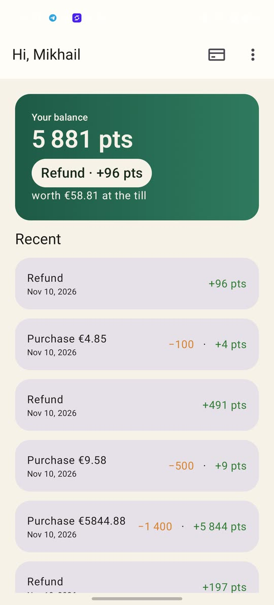
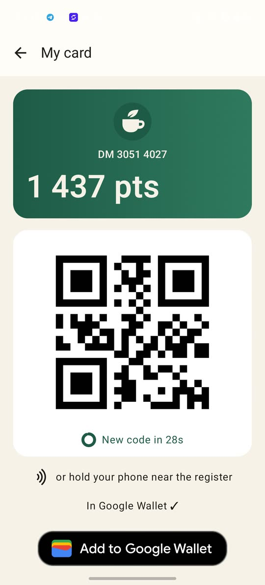
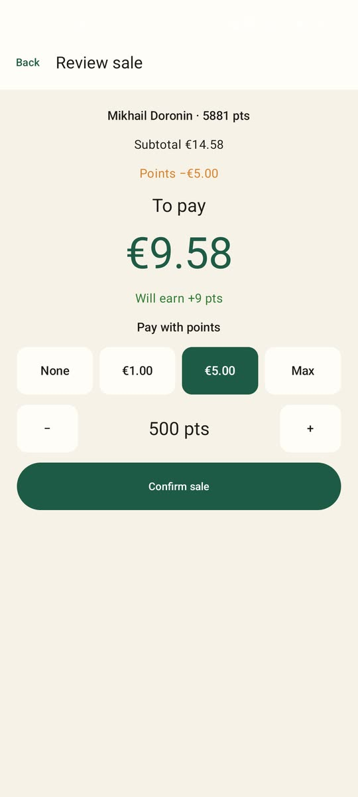
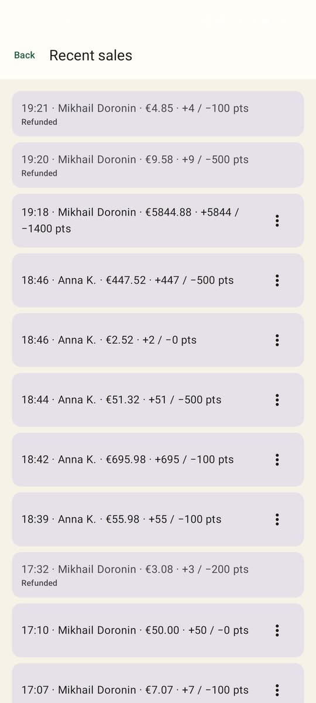
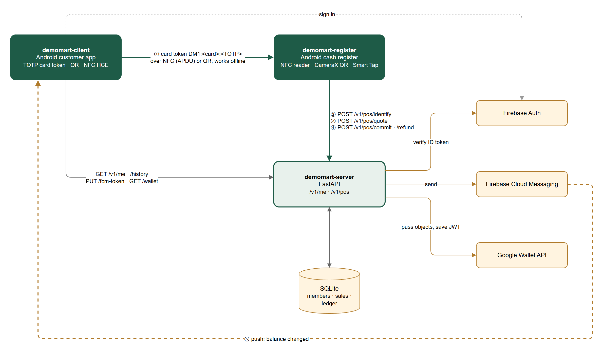
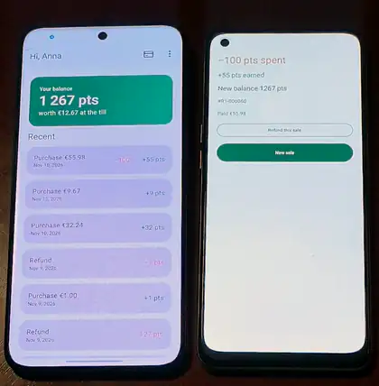
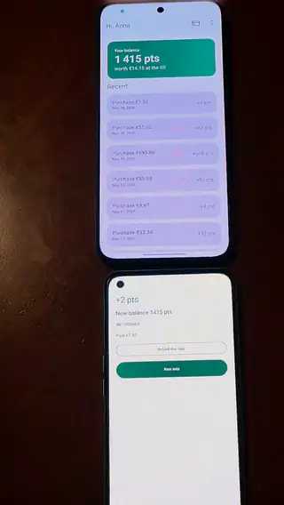

<h1 align="center">DemoMart</h1>

<a href="https://github.com/DoroninMA/demomart-client">Customer app</a> · <a href="https://github.com/DoroninMA/demomart-register">Register</a> · <a href="https://github.com/DoroninMA/demomart-server">Server</a>

A demo loyalty card system: a customer app, a cash register app and a backend. Customers earn 1 point per euro and can spend points at the register (100 points = €1).

| Repo | What it is |
|---|---|
| [demomart-register](https://github.com/DoroninMA/demomart-register) | Android cash register: reads the card over NFC or QR, redeems points, refunds |
| [demomart-client](https://github.com/DoroninMA/demomart-client) | Android customer app: card with rotating QR, NFC card emulation, balance and history |
| [demomart-server](https://github.com/DoroninMA/demomart-server) | Backend: FastAPI + SQLite, Firebase Auth, FCM, Google Wallet passes |

## How it works

The card token is a TOTP code generated on the phone, so the card works offline and the same token goes over QR and NFC. The register sends it to the server, gets the customer and balance back, and commits the sale. The customer app gets a push and animates the new balance.

The card can also be saved to Google Wallet, and the register scans the QR on the pass. Reading the pass over NFC (Smart Tap) is implemented too, but it needs a collector ID approved by Google.

Each repo has its own README with build and setup steps.

## Demo

| Pay over NFC | Pay by QR |
|---|---|
|  |  |

## License

MIT
